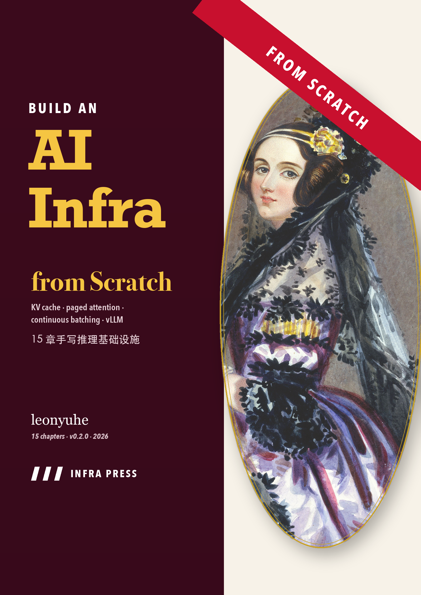
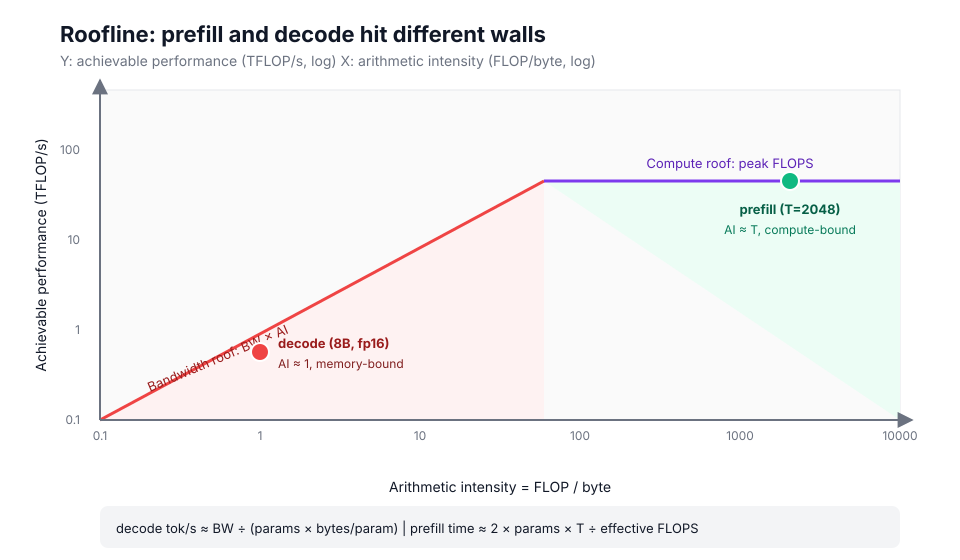
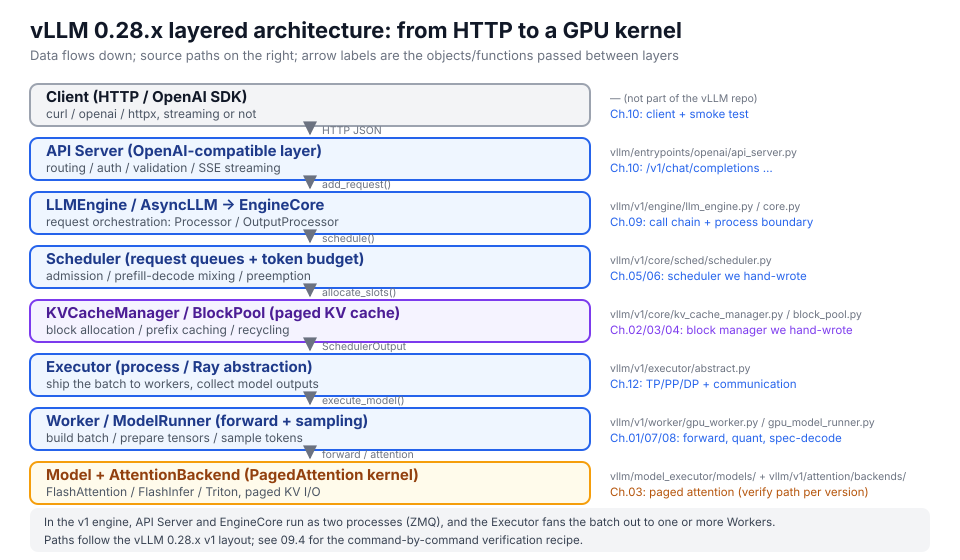

# AI Infra 从零构建（From Scratch）


[](https://github.com/leonyuhe/ai-infra-course/releases)

**在线阅读：<https://leonyuhe.github.io/ai-infra-course/>** ｜
**PDF 讲义：<https://github.com/leonyuhe/ai-infra-course/releases>**

<p align="center"></p>

> 一套「先造轮子、再读工业实现」的 AI 推理基础设施课程。
> 灵感来自 Sebastian Raschka 的 *Build a Large Language Model (From Scratch)*：
> 每章先建立直觉 → 手写最小实现 → 亲手测量 → 对照 vLLM 源码 → 练习迁移。

**三句话说完这套课：**

- 你会用不到 100 行手写 KV cache、分页显存、连续批处理调度器、int4 量化和投机解码；
- 每个机制都用同一套口径量出**数字**（延迟、吞吐、显存、误差），而不是「感觉快了」；
- 最后把这些数字和 vLLM 0.28.x 的真实文件、类名、参数对上号——线上出异常时能定位到哪一行。



## 这套课解决什么问题

会用 `vllm serve` 不等于理解 vLLM。真正的分水岭是：**看到延迟/吞吐异常时，能不能说出原因、找到参数、定位到源码**。

所以每一章都要求你：

1. 用 100 行以内手写一个核心机制（KV cache、分页、调度器、量化、投机解码）；
2. 用统一的测量口径跑出**数字**（延迟、吞吐、显存、误差）；
3. 把数字和 vLLM 的真实实现对上号（文件路径 + 类名 + 参数名）。

## 你会在书里反复遇到这四样东西

它们不是排版装饰，是四种「把知识钉牢」的手法：

| 标记 | 模样 | 为什么有用 |
| --- | --- | --- |
| **先猜一下** | 每个实验前给你一道选择题 | 先下注再揭晓，读到的结论才留得住；猜错的那一次记得最久 |
| **⚠️ 坑** | 一个新手必踩、踩了差一个数量级的点 | 把「知道」变成「不会写错」，并给出错多少倍的量级 |
| **一句话记住** | 每章末尾一句可背诵的判据 | 半年后忘了推导，还记得该先看哪个数 |
| **工作场景题** | 公司里真会遇到的问法 | 练习的不是算题，是从现象反推到机制 |

## 硬件要求

| 章节 | 硬件 | 说明 |
| --- | --- | --- |
| 00–11（本地部分） | Apple Silicon Mac（16GB+ 内存）| 随机权重 TinyGPT 约 2.8M 参数，CPU/MPS 都能秒级跑 |
| 10–11（真服务） | Mac + `vllm-metal`，或任意 NVIDIA GPU | 无服务时 Notebook 自动降级为 fixture 回放 |
| 12–14 | NVIDIA GPU（云） | 代码与脚本已写好，本地走模拟路径，上云后执行真实实验 |

全课程已在 **Mac Studio M3 Ultra / 96GB / macOS 26.3** 上无头执行验证通过。

## 快速开始

```bash
make venv        # 建 .venv 并安装依赖（需要 uv）
make build       # .py -> .ipynb
make test        # 共享库回归测试
make execute     # 无头执行全部 15 章（约 40 秒）
.venv/bin/python -m jupyter lab notebooks/
```

单章调试：

```bash
.venv/bin/python tools/build_notebooks.py --only 03
.venv/bin/python tools/execute_notebooks.py --only 03 --timeout 300
.venv/bin/python tools/check_notebooks.py --only 03
```

## 课程地图



| # | 章节 | 核心问题 | 本章实测结论（M3 Ultra） |
| --- | --- | --- | --- |
| 00 | [环境、硬件与度量方法](notebooks/00_setup_and_measurement.ipynb) | 怎么测才可信？ | 不同步的计时低估 **30×**；p90 决定 SLO |
| 01 | [一次前向：从矩阵乘法到 token 采样](notebooks/01_forward_and_sampling.ipynb) | prefill/decode 的瓶颈为什么不同？ | 实测带宽 ≈500–550 GB/s；decode 是带宽 bound |
| 02 | [KV Cache](notebooks/02_kv_cache.ipynb) | 显存到底被谁吃了？ | 生成 1536 token：naive ≈24s vs cached ≈2.5s |
| 03 | [PagedAttention](notebooks/03_paged_attention.ipynb) | 连续分配浪费了多少内存？ | 碎片率 **73.9% → 1.3%**，同等显存可放请求 32 → 116 |
| 04 | [前缀缓存](notebooks/04_prefix_caching.ipynb) | 相同 system prompt 为什么要算两遍？ | TTFT 降 2–4×；CPU 对照 11.3× |
| 05 | [调度器](notebooks/05_scheduler.ipynb) | 为什么连续批处理吞吐更高？ | 吞吐 **2.55×**，TTFT p95 21.3s → 1.2s |
| 06 | [Chunked Prefill 与抢占](notebooks/06_chunked_prefill.ipynb) | 长 prompt 为什么拖慢所有人？ | TPOT p95 173ms → 50ms，代价 -3.3% 吞吐 |
| 07 | [量化](notebooks/07_quantization.ipynb) | int4 为什么能快 2–4 倍？误差从哪来？ | int4 误差 2%，显存/理论 tok/s 严格 4× |
| 08 | [投机解码](notebooks/08_speculative_decoding.ipynb) | 小模型猜、大模型验，什么时候划算？ | 同权重 α=1；实测 1.2–2.9×，α<0.3 反而变慢 |
| 09 | [vLLM 架构与源码地图](notebooks/09_vllm_architecture.ipynb) | 我们的 100 行对应它哪个文件？ | 连续批 3.3×；对照表 9 行 + 源码地图 |
| 10 | [用 vLLM 提供服务](notebooks/10_serving.ipynb) | OpenAI API / LoRA / 结构化输出怎么接？ | 8B/80G 可放 36.3 万 KV token |
| 11 | [压测与调优](notebooks/11_benchmarking.ipynb) | 吞吐上不去，先看哪里？ | 吞吐拐点 32 并发；决策树 + 6 个参数清单 |
| 12 | [多卡并行](notebooks/12_multi_gpu.ipynb) | TP/PP/DP 切的是什么？通信多贵？ | TP=8 扩展效率 NVLink 0.89 / 以太网 0.50 |
| 13 | [训练侧 infra](notebooks/13_training_infra.ipynb) | DDP/ZeRO 的显存账本、LoRA 闭环 | 7B/8 卡：DDP 112GB → ZeRO-3 14GB；LoRA 合并等价 |
| 14 | [Capstone：容量规划](notebooks/14_capstone.ipynb) | 给定 SLO 和预算，怎么选卡？ | 8B int4 方案 $8.3k/月满足 100 QPS |

完整设计（教学法、验收标准、6 天排期）见 [COURSE_DESIGN.md](COURSE_DESIGN.md)；
写作与代码规范见 [STYLE_GUIDE.md](STYLE_GUIDE.md)。

## 验证结果

| 检查 | 命令 | 结果 |
| --- | --- | --- |
| 结构检查 | `make check` | **15/15 PASS**（五段式 / 图 / 表 / assert / 练习 / 英文图内文字） |
| 共享库测试 | `make test` | 5/5 PASS（分块 prefill、cached 生成等价、KV 账本、采样、溢出） |
| 无头执行 | `make execute` | **15/15 PASS**，单章最长 14.6s（ch08），总计约 38s |

> 表里的绝对值来自 M3 Ultra 的一次参考运行。带宽、延迟这类数字会随机器和负载浮动 ±10% 左右，
> **趋势和结论是稳定的**——本书每一章的断言和结论都只依赖趋势，不依赖某个具体读数。

## 仓库结构

```
CHAPTER_PATTERN.md  统一的章节写作模式（目标→设计→分步→实验）
aiinfra/            共享库：TinyGPT（含 KV cache 接口）、bench、plotting
notebooks/          章节源文件 .py（percent 格式）+ 构建产物 .ipynb
assets/figures/     手绘 SVG 概念图（17 张，全英文图内文字）
solutions/          练习参考答案（02–14 章）
cloud/              云上执行资产：Docker、起服务/压测/多卡/LoRA 脚本、fixture、成本表
tools/              build / execute / check / test_lib
outputs/            Notebook 运行生成的图表（gitignore）
```

## 云上部分怎么用

12–14 章在本地以模拟路径跑通，真正的多卡实验按 `cloud/README.md` 与
`cloud/README_training.md` 操作：AutoDL / RunPod / Lambda 三种平台的开机、拉镜像、
起服务、压测、关机 checklist 与成本表都已写好。注意脚本自带关机提醒——**跑完先关机再离开**。

## 课程状态

- [x] 00–14 全部 15 章
- [x] 17 张概念图 + 30+ 张实测图
- [x] 13 份练习答案
- [x] 云上脚本与文档
- [x] v0.2 全书叙述重写：场景钩子、先猜后验、⚠️ 坑、时间轴、收尾三件套
- [ ] 上云执行真实多卡实验，用实测数据替换 fixture 回放
- [ ] 导出 PDF / 录像（可选）

## v0.2 这一版改了什么

v0.1 把「结构」搭对了：每章五段式、有实测、有断言、有 vLLM 对照。但读起来像一份写得很好的
手册——信息密度够，拉力不足。v0.2 只动**讲法**，不动结论：

| 维度 | v0.1.1 | v0.2 |
| --- | --- | --- |
| 开场 | 直接进定义 | 一个值班/周会里真会遇到的场面，再点破机制 |
| 阅读方式 | 陈述结论 | 20+ 处「先猜一下」，先下注再揭晓，并解释错误选项为什么像对的 |
| 类比 | 偶有 | 每个抽象机制都有「日常类比 + 换成真实字节数的落点」 |
| 踩坑提醒 | 散落在正文 | 独立 ⚠️ 标记，写明错多少倍、错成什么现象 |
| 时间轴 | 少 | 调度器/分页/投机解码等有状态机制配 text 时间轴 |
| 章末 | 小结 + 练习 | 小结 + 练习 + **一句话记住 / 自检 3 问 / 工作场景题** |
| 正文体量 | 约 6.1 万中文字 | 约 8.1 万中文字（+33%），全部用于讲清机制，不注水 |

代码、实测数字、断言、章节结构（五段式与 NN.x 编号）与 v0.1.1 逐字一致——写作规范见
[POLISH_GUIDE.md](POLISH_GUIDE.md)。

## 许可

代码以 [MIT License](LICENSE) 发布；课程文档（Notebook 正文、图表）建议署名后使用。
